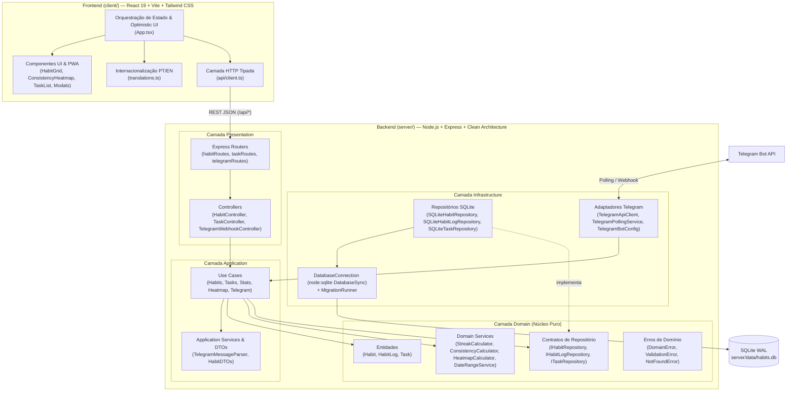
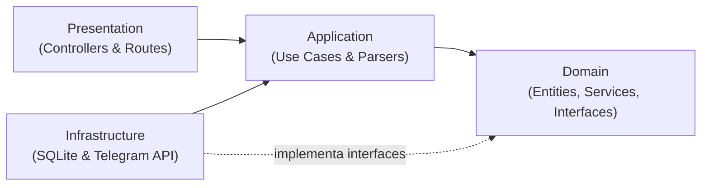
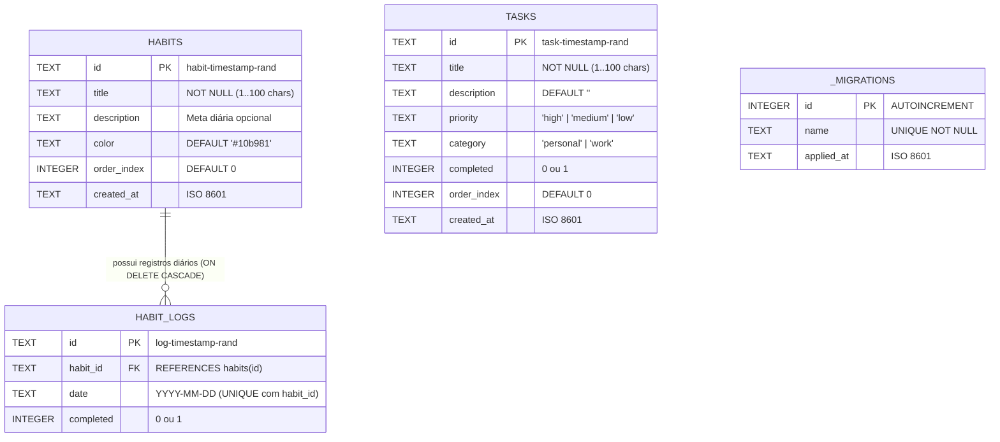

# Arquitetura do Sistema — Kairos

O **Kairos** é uma aplicação full-stack moderna para acompanhamento de hábitos diários, análise de consistência e gerenciamento de tarefas pessoais e profissionais (com integração via bot do Telegram). O projeto foi desenhado segundo os princípios da **Clean Architecture** no backend e arquitetura modular orientada a componentes no frontend.

---

## 1. Visão Geral e Topologia

---

## 2. Clean Architecture no Backend (`server/src/`)

A regra central (**Dependency Rule**) determina que as dependências de código apontam exclusivamente para dentro (em direção ao Domínio). Essa regra é verificada automaticamente pelo gate [`scripts/gates/arch-gate.mjs`](./scripts/gates/arch-gate.mjs) (`npm run gate:arch`).

### 2.1. Camada `domain/` (Núcleo de Negócio)
Não possui dependências externas, frameworks HTTP ou acesso a banco de dados:
- **Entidades (`domain/entities/`)**:
  - [`Habit.ts`](./server/src/domain/entities/Habit.ts): Valida título obrigatório (`1..100` caracteres), cor hexadecimal padrão (`#10b981`) e índice de ordenação.
  - [`HabitLog.ts`](./server/src/domain/entities/HabitLog.ts): Representa o registro de conclusão de um hábito em uma data específica (`YYYY-MM-DD`).
  - [`Task.ts`](./server/src/domain/entities/Task.ts): Valida título (`1..100` caracteres), prioridade (`high` | `medium` | `low`) e categoria (`personal` | `work`).
- **Serviços de Domínio (`domain/services/`)**:
  - [`StreakCalculator.ts`](./server/src/domain/services/StreakCalculator.ts): Calcula a sequência perfeita de dias consecutivos com 100% dos hábitos concluídos. Se o dia atual ainda não estiver 100% concluído, preserva a sequência acumulada até ontem.
  - [`ConsistencyCalculator.ts`](./server/src/domain/services/ConsistencyCalculator.ts): Calcula o percentual de consistência semanal ($\text{round}(\frac{\text{concluídos}}{\text{hábitos} \times 7} \times 100)$).
  - [`HeatmapCalculator.ts`](./server/src/domain/services/HeatmapCalculator.ts): Converte a taxa diária de conclusão em níveis discretos de intensidade `0..4` (`0`: 0%, `1`: $\le 25\%$, `2`: $\le 50\%$, `3`: $\le 75\%$, `4`: $> 75\%$).
  - [`DateRangeService.ts`](./server/src/domain/services/DateRangeService.ts): Utilitários determinísticos para cálculo da semana corrente (Segunda a Domingo) e janelas de semanas do Heatmap em fuso local.
- **Contratos de Repositório (`domain/repositories/`)**:
  - `IHabitRepository`, `IHabitLogRepository` e `ITaskRepository`.
- **Erros de Domínio (`domain/errors/DomainError.ts`)**:
  - `DomainError` (base, HTTP `422`), `ValidationError` (HTTP `400`) e `NotFoundError` (HTTP `404`).

### 2.2. Camada `application/` (Casos de Uso)
Orquestra o fluxo de negócio combinando entidades, serviços de domínio e interfaces de repositório:
- **Casos de Uso de Hábitos**:
  - `GetHabitsWithWeekUseCase`: Retorna todos os hábitos acompanhados do status dos 7 dias da semana atual.
  - `GetDashboardStatsUseCase`: Calcula `perfectStreakDays`, `weeklyConsistencyPct`, resumo de hoje e `weekDailySummary`.
  - `GetHeatmapUseCase`: Constrói a matriz histórica de semanas (padrão 20–22 semanas) com `totalActiveDays` e `completionRatePct`.
  - `CreateHabitUseCase`, `UpdateHabitUseCase`, `DeleteHabitUseCase`, `ToggleHabitLogUseCase`, `MarkAllTodayUseCase`, `ResetWeekUseCase`.
- **Casos de Uso de Tarefas (`TaskUseCases.ts`)**:
  - `GetTasksUseCase`, `CreateTaskUseCase`, `UpdateTaskUseCase`, `ToggleTaskUseCase`, `DeleteTaskUseCase`, `CompleteAllTasksUseCase`, `ClearCompletedTasksUseCase`.
- **Casos de Uso e Serviços do Telegram**:
  - `TelegramMessageParser`: Analisa mensagens de texto e comandos (`/tarefas`, `/tarefa`, `/ajuda`), extraindo tags de categoria (`#work`, `#pessoal`), prioridade (`!alta`, `!media`, `!baixa`) e descrições separadas por `|` ou múltiplas linhas.
  - `HandleTelegramUpdateUseCase`: Aplica autorização *Zero-Trust* por `TELEGRAM_ALLOWED_CHAT_IDS` e executa a criação ou listagem de tarefas.

### 2.3. Camada `infrastructure/` (Persistência e Clientes Externos)
- **Banco de Dados (`DatabaseConnection.ts`)**: Utiliza o módulo nativo `node:sqlite` (`DatabaseSync`) com `PRAGMA journal_mode = WAL` e `PRAGMA foreign_keys = ON`.
- **Migrações (`MigrationRunner.ts`)**: Executa arquivos `.sql` em `server/migrations/` em ordem alfabética dentro de transações `BEGIN` / `COMMIT`, registrando o histórico na tabela `_migrations`.
- **Repositórios SQLite (`SQLiteHabitRepository`, `SQLiteHabitLogRepository`, `SQLiteTaskRepository`)**: Implementam as interfaces do domínio usando *prepared statements*.
- **Integração Telegram (`infrastructure/telegram/`)**:
  - `TelegramBotConfig`: Carrega configurações de ambiente e sanitiza tokens em logs (`sanitizeSensitiveText`).
  - `TelegramApiClient`: Cliente HTTP para `getUpdates` e `sendMessage`.
  - `TelegramPollingService`: Loop de *polling* assíncrono com suporte a `AbortController` e *graceful shutdown*.

### 2.4. Camada `presentation/` e Composition Root (`app.ts`)
- [`server/src/app.ts`](./server/src/app.ts) atua como **Composition Root**, instanciando o banco, repositórios, casos de uso e controllers, e permitindo injeção de banco `:memory:` e mocks nos testes de integração (`createApp(options)`).
- Em produção, o Express também serve o bundle estático compilado do frontend (`client/dist`).

---

## 3. Modelo de Dados (SQLite)

---

## 4. Arquitetura do Frontend (`client/src/`)

- **Gerenciamento de Estado e Optimistic UI (`App.tsx`)**:
  - Carrega inicialmente os dados do dashboard de hábitos (`getHabits`, `getStats`, `getHeatmap(22)`) em paralelo via `Promise.all`.
  - Carrega a lista de tarefas sob demanda (*lazy loading*) na primeira abertura da aba **Tarefas**.
  - Aplica **Optimistic UI** ao alternar um dia de hábito (`handleToggleDay`) ou status de tarefa (`handleToggleTask`), atualizando a tela instantaneamente e sincronizando em plano de fundo (com reversão automática em caso de erro).
- **Isolamento de API (`client/src/api/client.ts`)**:
  - Centraliza todas as chamadas `fetch('/api/...')` e tratamento de erros HTTP. O gate de arquitetura proíbe chamadas `fetch` diretas dentro de `client/src/components/`.
- **Internacionalização (`client/src/i18n/translations.ts`)**:
  - Dicionário tipado com suporte completo a Português (`pt`) e Inglês (`en`), persistido em `localStorage` (`habit_tracker_lang`).

---

## 5. Quality Gates Automatizados (`scripts/gates/`)

O repositório possui três gates de verificação estática que rodam antes dos testes automatizados (`npm test` / `npm run gate:all`):

1. **Architecture Gate (`npm run gate:arch`)**: Valida fronteiras entre camadas (`domain`, `application`, `infrastructure`, `presentation`), isolamento da API no cliente, ausência de ciclos de dependência e extensões `.js` ESM.
2. **Linter Gate (`npm run gate:lint`)**: Executa `tsc --noEmit` no servidor e cliente, bloqueia `console.log`/`debugger`/`alert`/`@ts-ignore`/`any` nas camadas centrais, valida tokens de cores do `DESIGN.md` e assegura paridade de chaves `pt`/`en`.
3. **AI Code Review Gate (`npm run gate:review`)**: Garante paridade de testes unitários para serviços de domínio, numeração sequencial e idempotência das migrations SQL, mapeamento de erros de domínio nos controllers e controle de tamanho de arquivos.

---

## 6. Build e Deploy em Produção (Docker)

O [`Dockerfile`](./Dockerfile) utiliza build multi-stage baseado em `node:23-alpine`:
1. **`client-builder`**: Compila o frontend React + Vite (`client/dist`).
2. **`server-builder`**: Compila o TypeScript do backend (`server/dist`).
3. **`runner`**: Imagem enxuta contendo apenas dependências de produção do servidor, migrações SQL, artefatos compilados e volume persistente em `/app/server/data/habits.db`, orquestrada via [`docker-compose.yml`](./docker-compose.yml) na porta `3001`.
